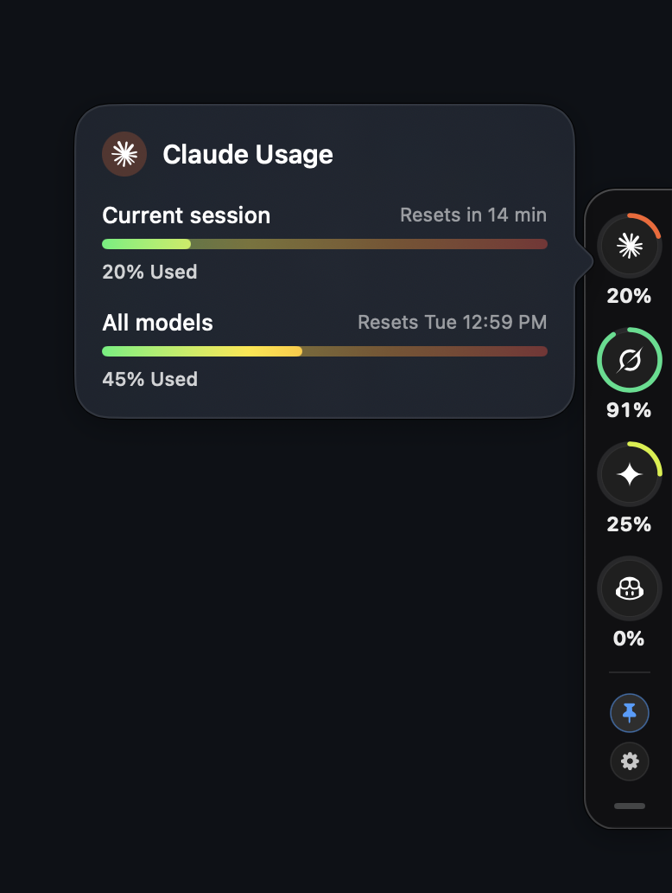
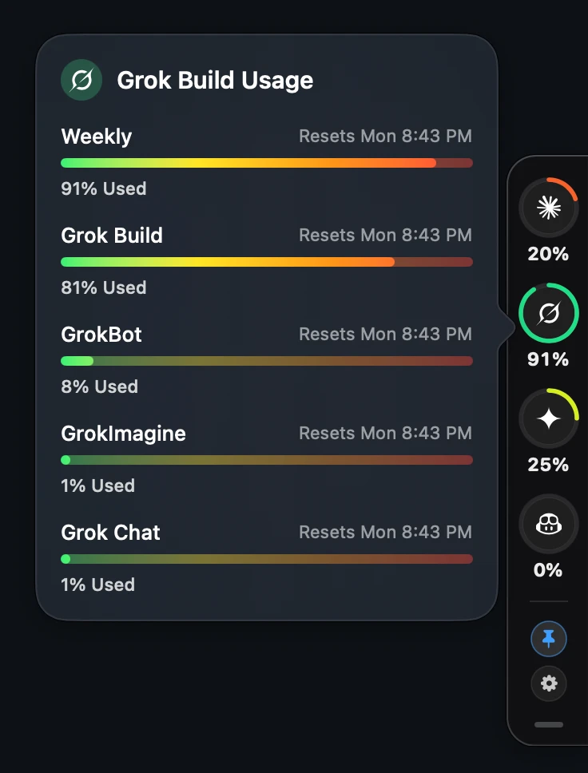

# Usage Sidebar

**Usage Sidebar** is an always-on-top, right-edge macOS utility pill that monitors **your live quota and credit usage** across top AI coding tools: **Claude Code**, **Grok Build**, **Google Antigravity**, and **GitHub Copilot**.

It never invents numbers: expired credentials show **—**, and SwiftUI previews are labeled **Sample**. Tools you aren't signed in to stay hidden, and appear by themselves within about a minute of signing in.

This is an `LSUIElement` accessory app (no Dock icon). Hover any badge to open a detailed flyout popover with quota breakdown and reset timers, or click it to keep the popover open. Click the bottom handle to collapse the sidebar into a slim edge tab, or click the settings gear to toggle launch at login and quit.

> **Unofficial Utility**: Reuses tokens and credentials already stored locally by those tools and queries the same usage endpoints they use internally. Credentials and secrets are never printed or transmitted to third parties.

<p align="center">
  
  
</p>

---

## ✨ Features & Design

- **Organic Right-Edge Scoop (`EdgeScoopShape`)**: Obsidian dark dock (`#0F0F12`) with rounded left corners and no right border, so it appears to come out of the right edge of your display.
- **Vertical Badge Widget System**:
  - 38×38pt circular badges with two rings. The inner ring is session usage in the provider's color. The outer ring is weekly usage on the same green-to-red scale as the popover bars, so red is only reached at 100%. A provider with no weekly limit has no outer ring.
  - High-legibility monospaced percentage readouts (`13pt .monospacedDigit()`) placed directly below each badge.
  - Interactive hover scaling and spring animations.
- **Hover Slide-In & Focusout Slide-Out**: Moving your mouse over the collapsed edge tab automatically slides the full dock into view; leaving the dock automatically stows it back into the edge tab after a 350ms grace period.
- **Pin / Always-Open Mode**: Click the pin icon in the bottom toolbar (or toggle in Settings) to keep the sidebar pinned open permanently.
- **Official Brand Vector Marks (`SVGPathEngine`)**:
  - 🟠 **Anthropic Claude**: Official 12-arm sunburst / asterisk vector mark (`#FA6129`).
  - 🟢 **xAI Grok Build**: Official dynamic sliced ring logo with flared top-right blade wing and tapered fin (`#21E08A`).
  - 🟡 **Google Antigravity**: Multi-faceted crystal snowflake starburst mark (`#D6F01F`).
  - 🔵 **GitHub Copilot**: Official GitHub Primer Octicons astronaut robot head with visor & eye cutouts (`#409EFF`).
  - Built with a pure Swift zero-dependency SVG path parsing engine (`SVGPathEngine`).
- **Collapsible Edge Tab**: Click the collapse handle to stow the sidebar into a minimal 18pt edge tab, or hover to expand.
- **Your Own Provider List**: Open **Manage Providers…** in Settings to remove built-in providers or add your own, up to 10 in all. A custom provider needs an HTTPS URL that returns usage as JSON, an API key, and the path to a 0-100 percent field, like `data.percent_used`. Keys are stored in the macOS Keychain and sent as a Bearer token to that URL only, and redirects are not followed. The app is ad-hoc signed, so another program running as you could read these keys. That is the same protection as the credential files the sidebar reads.
- **Integrated Settings Popover**: Dedicated gear button for "Start at Login" configuration (`SMAppService`), Auto-Hide preferences, and quick app termination.
- **Detailed Quota Popovers**:
  - Live progress bars that show the full scale, blending from green through yellow and orange to red. The used part is bright and the rest is dimmed, so red is only reached at 100%.
  - Humanized reset countdowns (e.g. *"Resets in 45 min"*, *"Resets Mon 10:00 AM"*).
  - Multi-tier bucket breakdowns (session limits, weekly caps, premium interactions).
  - Active popover protection keeps the dock open while reading details.
- **Multi-Monitor Awareness**: Automatically repositions and anchors flush to the active screen on display configuration changes.
- **Native App Icon**: A usage ring on an obsidian tile (`AppIcon.icns`), drawn by `scripts/make-icon.swift`.

---

## 📋 Requirements

- **macOS 14.0 (Sonoma)** or later
- **Apple Silicon (arm64)** or **Intel (x86_64)** Mac
- **Xcode Command Line Tools** (`xcode-select --install`) for `swiftc` compilation

---

## 🛠️ Build & Installation

Build the native `.app` bundle without needing a full Xcode IDE project:

```bash
cd usage-sidebar
bash scripts/build-app.sh
open dist/UsageSidebar.app
```

The build script compiles all Swift sources in `Sources/` into a single standalone binary and packages `dist/UsageSidebar.app` (`LSUIElement=true`, `LSMinimumSystemVersion=14.0`).

### Gatekeeper / Quarantine
If macOS Gatekeeper blocks opening an unsigned local build:

```bash
xattr -d com.apple.quarantine dist/UsageSidebar.app
```

> **Tip**: Copying `UsageSidebar.app` to `/Applications` makes login items (`SMAppService`) more reliable across reboots.

### Tests

`bash scripts/test.sh` compiles the non-UI sources and runs `Tests/main.swift`.

### Versioning

`bash scripts/install-hooks.sh` once per clone. The pre-commit hook then bumps `CFBundleShortVersionString` (patch) and `CFBundleVersion`, and moves `CHANGELOG.md`'s `[Unreleased]` notes under that version. Put `[skip version]` in a `git commit -m` message, or set `USAGE_SIDEBAR_SKIP_VERSION=1`, to commit without a bump. Amends and merges do not bump.

---

## 🔑 Persistent Non-Interactive Authentication

Usage Sidebar reads tokens other tools already stored. Claude Code's **live** OAuth is Keychain item `Claude Code-credentials` (the `~/.claude/.credentials.json` copy is often weeks stale).

Those items trust `/usr/bin/security` (`apple-tool:`), not this app. The sidebar reads them through that tool, so macOS does not ask for your login password on launch or on the 60s poll. A direct Keychain read from the app raises that sheet, and Always Allow is wiped the next time Claude or Antigravity rewrites the item.

| Provider | Primary | Fallback |
|---|---|---|
| **Claude Code** | Keychain `Claude Code-credentials` (unexpired) | `~/.claude/.credentials.json` |
| **Grok Build** | `~/.grok/auth.json` | — |
| **Google Antigravity** | `~/.gemini/antigravity-cli/oauth_creds.json`, `~/.gemini/oauth_creds.json`, or local Language Server | `gemini` (account `antigravity`) |
| **GitHub Copilot** | `~/.config/gh/hosts.yml` or `gh auth token` | `gh:github.com` |

---

## 📡 Where Credentials Come From

1. **Anthropic Claude**:
   - Reads Keychain `Claude Code-credentials` first (live token), then `~/.claude/.credentials.json` if it is still valid.
   - `GET https://api.anthropic.com/api/oauth/usage` with header `anthropic-beta: oauth-2025-04-20`.
   - Inner ring tracks the 5-hour rolling session percentage. Outer ring tracks weekly all-models utilization. Popover details both.
   - *Note: Does not refresh OAuth tokens to prevent rotating Claude Code's active session.*
2. **xAI Grok Build**:
   - Reads from `~/.grok/auth.json` (`https://accounts.x.ai/sign-in`.key, `{issuer}::{client_id}`.key, or `access_token`).
   - `GET https://cli-chat-proxy.grok.com/v1/billing?format=credits` with `x-grok-client-surface: grok-build` and `X-XAI-Token-Auth: xai-grok-cli`.
   - Outer ring tracks `config.creditUsagePercent`. Grok reports no session limit, so the inner ring and caption show the Grok Build entry in `config.productUsage`. If that entry is missing, the inner ring stays empty and the caption shows the weekly value. On a monthly period, or without `creditUsagePercent`, there is no outer ring and the inner ring shows the first row. Popover shows the quota and billing period reset date.
3. **Google Antigravity**:
   - Reads from `~/.gemini/antigravity-cli/oauth_creds.json`, `~/.gemini/oauth_creds.json`, `~/.agy`, or `~/Library/Application Support/Antigravity`.
   - Primary: `POST https://daily-cloudcode-pa.googleapis.com/v1internal:retrieveUserQuotaSummary`.
   - Fallback: Connects via local loopback language server (`RetrieveUserQuotaSummary` / `GetUserStatus` on `127.0.0.1` via TLS with `LocalTrustDelegate`).
   - Inner ring displays the plan's session limit (`gemini-5h`), then `gemini-weekly`, then the highest bucket if those are missing. Outer ring displays `gemini-weekly`. Other limits, including per-model ones, are listed in the popover. The local language server `GetUserStatus` fallback shows the scarcest Gemini model on the inner ring and has no outer ring.
4. **GitHub Copilot**:
   - Reads from `~/.config/gh/hosts.yml` or `gh auth token`.
   - `GET https://api.github.com/copilot_internal/user` → `quota_snapshots`.
   - Paid plans: ring displays `premium_interactions`. Free plans have no Premium allowance, so that row is hidden and the ring displays `chat` or `completions`, whichever is higher, and the popover says **Free plan**. Unlimited buckets display **∞** / **Unlimited**.

Each provider polls independently every ~60 seconds. On HTTP 429 it waits for `Retry-After` (60 seconds if the header is missing, at least 30 seconds, at most 1 hour). Other errors back off gradually, up to 5 minutes.

---

## 🗂️ Project Structure

```
usage-sidebar/
├── CHANGELOG.md              # Version release notes and history
├── LICENSE                   # MIT License
├── README.md                 # Project documentation and guide
├── Sources/
│   ├── App/
│   │   ├── LoginItem.swift       # SMAppService registration for auto-start
│   │   ├── UsageSidebarApp.swift # App lifecycle, NSPanel floating window & edge snapping
│   │   └── UsageStore.swift      # Multi-provider state management & concurrency loops
│   ├── Models/
│   │   └── Models.swift          # Data models, color palettes, math & date parsers
│   ├── Providers/
│   │   ├── AntigravityProvider.swift # Cloud Code PA API & local language server polling
│   │   ├── ClaudeProvider.swift      # Anthropic OAuth usage API polling
│   │   ├── CopilotProvider.swift     # GitHub internal Copilot quota API polling
│   │   ├── CustomProviderClient.swift # User-configured JSON usage URL polling
│   │   └── GrokProvider.swift        # xAI CLI billing proxy API polling
│   ├── Support/
│   │   ├── JSONMap.swift         # Dynamic JSON tree traversal and safe casting
│   │   └── Secrets.swift         # Keychain query, process execution, token regex redaction
│   ├── Views/
│   │   ├── ProvidersWindow.swift # Manage Providers window and add-provider form
│   │   └── Views.swift           # SwiftUI UI, EdgeScoopShape, SVGPathEngine, and popovers
│   └── Info.plist                # LSUIElement, macOS 14 bundle configuration
├── Tests/
│   └── main.swift                # Parser and bar scale checks
├── dist/                         # Compiled macOS application output (UsageSidebar.app)
└── scripts/
    ├── build-app.sh              # Standalone swiftc build & code signing script
    ├── build-icon.sh             # Builds AppIcon.png and AppIcon.icns
    ├── bump-release.py           # Version and changelog bump
    ├── hooks/pre-commit          # Runs the bump on commit
    ├── install-hooks.sh          # Installs the pre-commit hook
    ├── make-icon.swift           # Draws the app icon
    └── test.sh                   # Compiles and runs the tests
```

---

## 📄 License

[MIT License](LICENSE). Designed for personal productivity.
